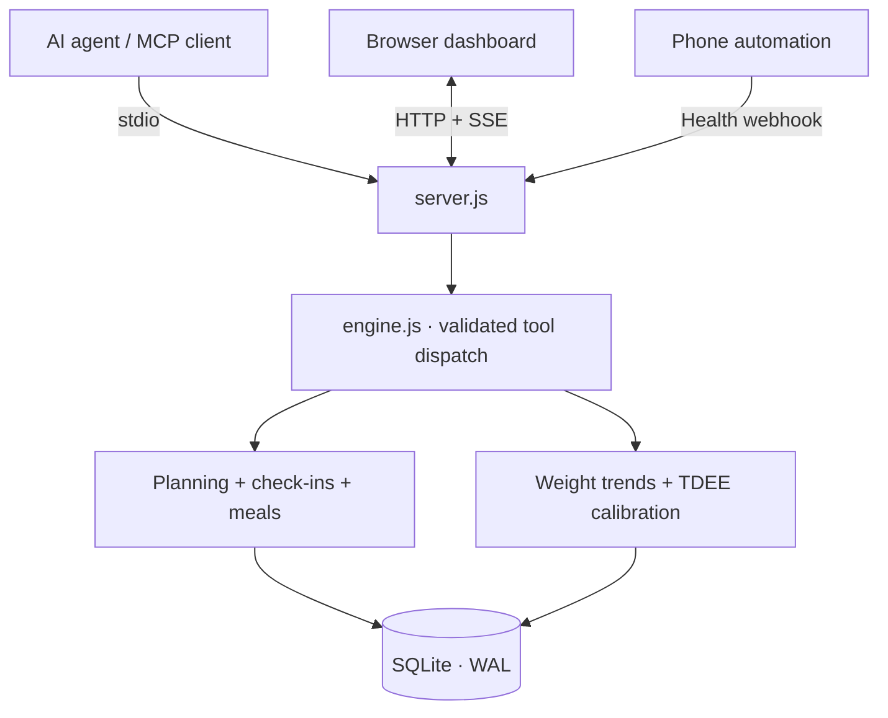

<div align="center">

# Nutrition Tracker MCP

**An agent-first nutrition MCP server with persistent food logging, reusable meals, and a read-only monitoring dashboard.**

[](https://nodejs.org/) [](https://modelcontextprotocol.io/)  

**[Remote MCP deployment (中文)](docs/REMOTE_MCP_DEPLOYMENT_ZH.md) · [Preview](#interface-preview) · [Quick start](#quick-start) · [Architecture](#architecture) · [MCP tools](#mcp-integration) · [Design decisions](#engineering-notes)**

</div>

---

## Product direction: easy to record, easy to correct

**Default user: an ordinary person developing a healthy habit, not a competitive athlete or a clinical patient.** Aim for one conversational turn to log a meal or daily observation. Agent estimates are acceptable when clearly labeled; save provenance and make corrections easy in chat and the Dashboard. Advanced carb cycling/TDEE remains opt-in, not an onboarding hurdle. The strict photo-review flow remains available, but should not be compulsory for casual records.

**[产品转向决策记录：为什么主动容忍合理误差](docs/PRODUCT_STRATEGY_AGENT_FIRST_ZH.md)** — documents the tradeoff between single-entry accuracy, user effort, continuity, traceability, correction, and real Agent evaluation.

## Interface strategy: professional first, reversible simplification

The Dashboard initially exposes existing professional nutrition, recovery and trend views. Users can switch to a simpler everyday view at any time **without deleting data or changing the underlying calculations**. This is a voluntary presentation preference: do not automatically infer user disengagement or apply a clinical/programmatic downgrade. Everyday tracking still supports fast meals, sleep, weight and activity. For meal text the Agent may save an explicitly labeled estimate in one user turn; **for meal photos it must first show a brief food-identification and portion preview and obtain one combined approval before saving**. See [the product pivot decision](docs/PRODUCT_STRATEGY_AGENT_FIRST_ZH.md).

## Current development: lightweight family NAS + compact Agent MCP

The current `main` implementation rebuilds household features **from the pre-family v5.3 baseline**. The household is the trusted boundary; member IDs label data, not accounts. No family SaaS login, per-member Bearer tokens or repeated sharing consent flows. Two default MCP tools replace the exposed dozens of low-level operations; the existing nutrition engine remains authoritative. Full legacy tools are available only with `MCP_TOOL_SURFACE=full` for migration.

**[家庭权限设计取舍及项目记录](docs/PROJECT_RECORD_ZH.md)** · **[中文部署、Agent 接入及使用场景](docs/HOUSEHOLD_LIGHTWEIGHT_ZH.md)** · Example configuration: [`household.example.json`](household.example.json) · Docker Compose overlay: [`compose.household.yml`](compose.household.yml).

**Access model:** Household `memberId` identifies record ownership, not member-level authentication. Choosing a shared NAS token over per-member credentials and consent gates was a deliberate tradeoff, not an omission: see the [project decision record](docs/PROJECT_RECORD_ZH.md) for the assumptions, risks and criteria for reintroducing granular permissions.

**Common Agent conversations (one or two tool calls):**

- **Family meal:** “We have chicken, potatoes and greens. What can we cook tonight?” → `nutrition_query({view:"household",focus:"food"})` → shared meal with per-person portion differences, normal eaters unaffected by an athlete's carb cycle.
- **Routine wellness:** “What has the family been like recently?” → `nutrition_query({view:"household",focus:"health"})` → recent sleep/HRV/resting heart rate/activity/weight and user-entered vitals; a relevant concern may be mentioned once naturally, not every turn.
- **Daily check-in:** “Jo slept only five hours last night.” → `nutrition_execute({operation:"checkin",memberId:"jo",args:{sleepHours:5}})` → direct brief updated context, no second snapshot call.
- **Food + logging:** “150g cooked rice and 180g chicken for Alex.” → batched `nutrition_query({view:"foods",memberId:"alex",queries:["cooked rice","chicken"]})` → verify food IDs and preparation → `nutrition_execute({operation:"meal",memberId:"alex",args:{mealSlot:"午餐",items:[...],requestId:"unique-meal"}})`.
- **Photo intake:** photo compiler MCP Prompt only on photo turns → ingredient matching → unconfirmed draft → user approval → confirmed write. Do not silently invent grams/macros.

The compact tool catalog reduces repeated model tool-selection context, but real Agent accuracy must still be evaluated from conversation traces. The optional Dashboard adds a read-only family summary; it is not the primary workflow.

---

This is a **personal engineering portfolio project** built as an **MCP tool module for AI agents**. Agents are the primary interface: users describe food, portion sizes, routines or corrections in conversation; the agent discovers foods, asks for missing evidence, and writes verified records through deterministic tools. The browser dashboard is secondary: it is for observation and review, not the primary workflow.

The application brings together daily food logging, weekly carb cycling, optional recovery signals, a weight-trend model, and conservative TDEE recalibration. An MCP client, browser dashboard, and phone webhook all read and write through **the same SQLite-backed engine**.

## v5.2 experiment: agent-first meal logging and photo estimate compilation

The central deliverable is a **compiled, schema-validated photo estimate**, not a generic image caption. It separates observed evidence, inferred food identity, edible mass ranges, unknowns and questions before the Agent performs local food-library matching. A photograph alone never creates a measured food weight.

> The historical feature notes below describe the underlying engine. In this development branch, the default Agent interface is the two-tool compact surface documented above.

MCP is the product interface. These features require **no dashboard UI**:

| Agent tool | Purpose |
| --- | --- |
| `get_agent_context` | Compact daily targets, consumed/remaining macros, recent meals, saved-template names; avoids passing the entire database into model context |
| `search_foods` | Look up food IDs and nutrient values per 100g without a full snapshot |
| `get_meal_history` | Inspect and correct a specific day's meal records |
| `log_meal_items` (extended) | Add a confirmed meal today or on a historical date; optional `requestId` protects against retried writes |
| `save_meal_template` | Snapshot a meal the user actually logged, preserving its portion and macro measurements |
| `list_meal_templates` | Retrieve known meal combinations with stable IDs |
| `log_meal_template` | Log a reusable meal with optional multiplier/date/slot and idempotency |
| `export_nutrition_data` | Read-only structured export (90 calendar days maximum per request) |
| `get_photo_estimation_protocol` | Return the canonical image-estimation prompt, evidence contract and example for Agent hosts that cannot use MCP Prompts |
| `stage_photo_estimate` | Schema-validate food identity guesses, gram ranges and their evidence into a persistent unconfirmed draft |
| `prepare_photo_meal` | Stage **only structured candidates from an external vision Agent**, with provenance and explicit uncertainty; no ledger mutation or image storage |
| `get_photo_meal_draft` | Fetch an unconfirmed photo draft across sessions |
| `confirm_photo_meal` | Commit the meal only after user-approved item/portion decisions; idempotent and audit-friendly |
| `discard_photo_meal` | Cancel an uncommitted photo draft |

**Illustrative conversation:** “Lunch was 200g chicken breast and 150g cooked rice; save it as my office lunch.” The agent should call `search_foods` for the ingredients, **confirm whether weights are raw or cooked**, then call:

```json
{"tool":"log_meal_items","args":{"mealSlot":"午餐","items":[{"foodId":"f1","weightGrams":200},{"foodId":"f7","weightGrams":150}],"requestId":"meal-confirmation-unique-123"}}
```

Once the ledger contains that meal, the agent may call `save_meal_template` with `{ "name": "Office lunch", "mealSlot": "午餐" }`. A later “Same office lunch as last time” is handled with `list_meal_templates` followed by `log_meal_template`, after confirming the user's intended portion size.

**Photo sharing:** A vision-capable AI Agent first invokes the built-in `estimate_meal_photo` MCP **prompt** (or the `get_photo_estimation_protocol` tool), which defines a strict JSON compilation contract for **visible evidence, likely food type, raw/cooked state, estimated edible grams with ranges, and explicit unknowns**. After `search_foods` matching, the Agent calls `stage_photo_estimate` to validate and persist an unconfirmed draft. The user checks identities, portions and missing sauces/oils, then the Agent calls `confirm_photo_meal` with explicit per-item decisions. The photo itself **is not passed to this MCP server and is never stored in its SQLite database**. The feature depends on an external vision-capable MCP host; ordinary text-only clients cannot inspect photos. Review the canonical [compilation protocol](docs/PHOTO_ESTIMATION_PROTOCOL.md) and [Agent workflow](docs/AGENT_WORKFLOWS.md).

**Rules and design constraints:**

- Food macros are **not inferred from a free-text sentence inside the engine**. The agent resolves user intent and invokes tools with concrete data; the deterministic backend validates, computes and persists results.
- **Do not silently invent grams, choose raw/cooked weights, or mark intake complete.** Agents must ask for missing material input. Template values represent the originally recorded portions, not a universal food composition standard.
- `requestId` should be stable across **retries of one user-confirmed write**, but different for a new meal even if identical. Reusing it with different arguments is an error.
- Backfilling or replaying meals reopens the day's `intake_complete` flag; TDEE calibration stays opt-in as in v5.1.
- Database migration adds template and request-receipt tables without rewriting existing meal records. New templates are stored as immutable nutritional snapshots.
- No **native** food photo recognition, embedded LLM, barcode lookup, autonomous dietary advice, or cloud sync has been added. The validated, bounded estimate is supplied by an **external** vision Agent; no silent photo-to-ledger commits.

See [Agent workflow reference](docs/AGENT_WORKFLOWS.md) for structured calls and the trust boundary.

## v5.2 agent workflow completion (alpha.3)

The MCP module now exposes the `nutrition_agent_workflow` Prompt (plus `get_agent_workflow` for Prompt-less hosts). It routes **text, photographed meals, food corrections, local templates and optional external USDA searches** into explicit, auditable tool calls. It is host-supplied guidance, not a guarantee that every Agent will auto-load prompts.

- `update_meal_item({mealId,expectedRevision,requestId,weightGrams,...})`: atomic correction of a persisted meal with optimistic revision checks, snapshot-based macro scaling, idempotent request receipt, daily ledger recalculation and an immutable `meal_corrections` before/after audit. `get_meal_corrections` reads the correction history.
- `confirm_photo_meal` now **requires** `confirmationEvidence:{channel,summary,reference?}`; the draft persists the source of the Agent's claimed explicit user approval. The MCP server cannot independently authenticate the user's chat approval.
- `search_usda_foods` and `get_usda_food_details`: opt-in **read-only MCP tools** using `FDC_API_KEY` server-side, limited to Foundation/SR Legacy references with complete per-100g P/C/F in grams. The Agent must still confirm identity and optionally save the reviewed record through `add_food_to_library`. External search never auto-records calories.
- The Dashboard remains secondary; all new functionality operates over MCP without a frontend dependency.

See [Agent runtime integration](docs/AGENT_RUNTIME.md) and [Photo protocol](docs/PHOTO_ESTIMATION_PROTOCOL.md). The USDA adapter is optional and does not block local meal logging when disconnected.

## Interface preview


*Actual dashboard UI with sample data (`npm run demo`); Simplified Chinese interface. The preview is an illustrative demo state, not personal health data.*

The visual direction is an **editorial training journal**: warm paper, ink-like typography, restrained vermilion, clear numerical hierarchy, and dense but legible data. The frontend is a single HTML/CSS/JavaScript file—no build pipeline required. See [`DESIGN.md`](DESIGN.md) for the original visual specification.

## Highlights

| | Capability | Implementation |
| --- | --- | --- |
| **01** | Weekly carb cycling | High / medium / low days; weekly-average P/C/F targets are normalized rather than independently improvised |
| **02** | Diet and supplement ledger | Meal portions, food library, daily totals, supplement check-ins, local persistence |
| **03** | Recovery inputs | Optional HRV, resting heart rate, sleep, activity, and weight check-ins |
| **04** | Adaptive TDEE | Weight-trend comparison, bounded corrections, calibration diagnostics |
| **05** | MCP-native controls | 2 default compact Agent tools; complete legacy tool catalog available only with `MCP_TOOL_SURFACE=full` |
| **06** | Live observability | HTTP dashboard, SSE updates, SQLite WAL and cross-process change detection |

## v5.1 correctness and safety changes

This release separates **observations** from **assumptions** and makes TDEE adjustments **opt-in**. It is an engineering prototype, not a validated clinical prediction model.

- TDEE calibration now uses the actual calendar span and only days whose intake has explicitly been marked complete. Missing records are never interpreted as zero calories.
- Calibration requests produce a **read-only preview by default**; `apply: true` is required to write. The same evidence cannot repeatedly move TDEE even with `force: true`.
- EWMA uses **measured scale weight**, not carbohydrate-preset glycogen-water subtraction. Glycogen and forecast outputs remain unvalidated illustrative scenarios.
- Recovery scores are heuristic indicators only; they **never automatically switch a training day to a low-carb day**, prescribe supplements, or assert CNS fatigue.
- Health data accepts an optional `measuredAt` with a time-zone offset and `sourceEventId` for deduplication; HRV inputs must specify `RMSSD` or `SDNN` (SDNN is not compared to the default RMSSD baseline).
- Browser writes use a same-origin session CSRF token, programmatic writes require `NUTRITION_API_TOKEN`, and health webhooks are disabled unless `HEALTH_WEBHOOK_TOKEN` is configured. Do not publicly expose the server without additional authentication and transport security.

**New workflow:** after finishing each day's intake, use the dashboard's **今日饮食已记录完整** button or the `mark_intake_complete` MCP tool. Updating logged meals resets the completion flag. For TDEE use `calibrate_metabolic_tdee({windowDays: 14})` to preview, then only after review `calibrate_metabolic_tdee({windowDays: 14, apply: true})`.

**Time-zone configuration:** set `NUTRITION_TIME_ZONE` to your IANA time zone (e.g. `Africa/Maputo`, `Asia/Shanghai`, `Europe/London`). Existing data is **not automatically migrated between time zones**; set the correct zone before collecting data.

**Authenticated HTTP examples:**

```bash
NUTRITION_TIME_ZONE=Africa/Maputo HEALTH_WEBHOOK_TOKEN=change-me npm start
curl -X POST http://127.0.0.1:3456/api/health-webhook \
  -H 'Authorization: Bearer change-me' -H 'Content-Type: application/json' \
  -d '{"source":"phone","sourceEventId":"measurement-123","measuredAt":"2026-10-17T07:00:00+02:00","scaleWeightKg":75.0}'
```

Tokens must be kept private; do not commit them to Git. The local browser dashboard obtains its own ephemeral write token via `/api/session` and does not need an environment variable. Programmatic HTTP tools can use `NUTRITION_API_TOKEN` as a Bearer token; stdio MCP remains separate.

**Migration notes:** older databases are migrated in-place by adding columns. Previous weight EWMA values and historical intake records are **not certified as complete**. Reconfirm logs before calibration; retain a backup of your SQLite file. The deprecated `dewatered_weight_kg` column now mirrors scale weight for newly processed readings. Earlier historical values are not bulk overwritten unless weight trends are recomputed.

## Quick start

**Requirements:** Node.js **22.13+**, npm. The project uses the built-in `node:sqlite` module. No API keys, cloud service, database server, or frontend build are required.

```bash
git clone https://github.com/Jasonatafricanow/Nutrition-Tracker-MCP.git
cd Nutrition-Tracker-MCP
npm ci
npm run demo
```

Open **http://127.0.0.1:3456** for the populated demo dashboard.

For a separate persistent ledger (instead of the seeded demo database), stop the demo and run:

```bash
npm start
```

```bash
npm test                # original regressions + new adversarial tests
```

The demo uses `macro_demo.db`; regular mode uses `macro_engine.db`. Database files and `node_modules` are ignored by Git.

## Architecture



**Boundary:** `server.js` owns transport, request routing and live updates. `engine.js` owns the model calculations, validation, storage and state transitions. The MCP interface **exposes** deterministic operations; it does **not** run its own LLM or independently generate training advice.

### Project layout

```text
Nutrition-Tracker-MCP/
├── engine.js                   # Nutrition model, tools, SQLite ledger
├── agent-workflow.js           # Canonical host-independent agent routing Prompt
├── usda-foods.js               # Optional read-only external food reference adapter
├── server.js                   # stdio MCP + HTTP API + SSE
├── viewport.html               # Standalone responsive dashboard
├── test/engine.test.js         # Node built-in test runner
├── assets/dashboard-preview.jpg
├── DESIGN.md                   # Interface design specification
├── package.json
├── package-lock.json
└── .github/workflows/ci.yml    # Reproducible test workflow
```

## Remote MCP (optional)

The experimental branch adds **authenticated Streamable HTTP MCP** on a separate `MCP_HTTP_PORT` (default 3457), while retaining local stdio and keeping Dashboard HTTP private. Remote MCP is **disabled by default**. It requires `MCP_HTTP_ENABLED=1`, a strong `MCP_HTTP_TOKEN`, TLS reverse proxy for off-machine access, and strict Host/Origin allowlists. No OAuth or multi-user isolation is provided. **See the [Chinese remote MCP / NAS deployment guide](docs/REMOTE_MCP_DEPLOYMENT_ZH.md)** for Docker Compose, Caddy, credentials, and Agent connection settings.

## MCP integration

**Primary operating path:** connect your agent as an MCP client. The dashboard is optional for monitoring and review.

Use this server as a local **stdio MCP** process. The path must point to your own checkout:

```json
{
  "mcpServers": {
    "nutrition-tracker-mcp": {
      "command": "node",
      "args": ["/absolute/path/to/Nutrition-Tracker-MCP/server.js"]
    }
  }
}
```

For Windows, use a path such as `C:/projects/Nutrition-Tracker-MCP/server.js`. Exact configuration locations vary by MCP host. Running in a terminal normally starts HTTP only; a client that connects over piped stdin activates the MCP transport as well.

| Tool | Purpose |
| --- | --- |
| `get_agent_context` | Get a compact Agent-oriented daily context for food logging |
| `get_snapshot` | Read the complete dashboard state, targets, history and diagnostics |
| `set_profile` | Update body parameters, activity factor, target and macro ratios |
| `log_morning_checkin` | Record weight, HRV, RHR, sleep and optional activity metrics |
| `calibrate_metabolic_tdee` | Preview the TDEE estimate; optionally apply with explicit approval |
| `mark_intake_complete` | Confirm or reopen a specific day’s intake log |
| `set_day_context` | Override today's carb level and training context |
| `update_weekly_schedule` | Modify individual days or the weekly template |
| `log_meal_items` | Log portions on a selected date with an optional retry-safe request ID |
| `search_foods` | Search foods by name and get stable IDs and per-100g macros |
| `get_meal_history` | Inspect one day of logged meals |
| `save_meal_template` | Save a real meal into a reusable snapshot template |
| `list_meal_templates` | Discover saved meals and their exact contents |
| `log_meal_template` | Replay a saved template with scaled portions and idempotency |
| `export_nutrition_data` | Export up to 90 days of JSON ledger/meal history |
| `delete_meal_item` | Remove a logged meal item |
| `add_food_to_library` | Extend the editable food library |
| `update_supplement_stack` | Mark today's supplement entry and dose text |

Read-only MCP resource: **`telemetry://snapshot`** (`application/json`).

## HTTP endpoints

| Method | Route | Use |
| --- | --- | --- |
| GET | `/` | Dashboard |
| GET | `/api/snapshot` | Complete JSON snapshot |
| GET | `/api/session` | Same-origin dashboard write token |
| GET | `/api/stream` | Server-Sent Events updates |
| POST | `/api/mcp-dispatch` | Invoke a validated engine tool |
| POST | `/api/health-webhook` | Import optional morning measurements |

Set `FDC_API_KEY` for optional USDA FoodData Central queries. Never put API keys in Agent messages. Details: [Agent runtime guide](docs/AGENT_RUNTIME.md).

The optional webhook accepts `weightKg` / `scaleWeightKg`, `hrvMs`, `hrvMetric`, `rhrBpm`, `sleepHours`, `deepSleepPct`, `steps`, `activeKcal`, `measuredAt`, `sourceEventId`, and `source`. It requires `Authorization: Bearer $HEALTH_WEBHOOK_TOKEN` and is disabled until that environment variable is configured. It does **not** connect directly to Apple Health or Health Connect.

| Environment variable | Default | Purpose |
| --- | --- | --- |
| `HOST` | `127.0.0.1` | HTTP bind address; do not expose publicly |
| `PORT` | `3456` | HTTP port |
| `DB_PATH` | project-local SQLite file | Override database path |
| `NUTRITION_TIME_ZONE` | host IANA time zone | Personal ledger date/time-zone attribution |
| `NUTRITION_API_TOKEN` | unset | Optional Bearer token for trusted programmatic HTTP writes |
| `HEALTH_WEBHOOK_TOKEN` | unset (disabled) | Required Bearer token for incoming health webhooks |
| `FDC_API_KEY` | unset (USDA lookup disabled) | USDA FoodData Central API credential; used only by the MCP process |

## Engineering notes

**Why a deterministic engine?** An assistant is good at interpreting a request, but calculations, mutation rules and persisted logs should produce repeatable results. Tool schemas validate inputs and the backend retains authority over state.

**Weekly budgeting, not seven unrelated targets.** Daily carb and fat multipliers are normalized against the actual weekly schedule, while protein stays constant. This keeps the week's intended energy/macronutrient budget approximately intact after rounding.

**Visible correction instead of hidden adaptation.** The calibration logic exposes inputs, intermediate estimates and limited TDEE steps (damping `0.35`, max correction `±120 kcal` per calibration, with an overall bounded range). Its carb-day glycogen/water scenarios and seven-day projections are **heuristic assumptions**, not clinically validated estimators. Calibration uses an ordinary least-squares trend over raw scale-weight observations and checks whether the disagreement exceeds an estimated measurement-noise threshold. This does **not** account for dietary underreporting or establish metabolic adaptation.

**Why SQLite and SSE?** One local ledger is shared across the MCP and web surfaces. SQLite WAL supports access from multiple processes; `PRAGMA data_version` polling lets an existing dashboard notice changes made by another instance. SSE keeps the browser dependency-free.


## Photo-estimation evaluation (Agent-first)

The photo compiler uses a strict intermediate representation, but **schema-valid JSON is not evidence of accurate food recognition or edible-gram estimation**. Run an isolated blind benchmark before claiming accuracy or changing the vision prompt.

```bash
node audit/eval-photo-estimates.mjs --example
node --test test/photo-benchmark.test.js
```

The committed example is **synthetic and contains no photographs**, so its printed percentages are *not* vision-model metrics. See [the weighed-photo benchmark protocol](docs/PHOTO_BENCHMARK.md) for the split reference / prediction / human-review files, confidence and interval-coverage measures, and private real-photo collection. Production MCP tools and Dashboard remain unchanged.

## Known limitations and security

- **Prototype / single-user** design. Browser write protection is based on same-origin CSRF tokens; programmatic HTTP writes use a manually configured bearer token. It is not a multi-user auth system. Local processes can reach the loopback interface. Keep the HTTP server on `127.0.0.1` and do not expose it on an untrusted network.
- **Interface language:** the dashboard, labels and many tool descriptions are in Simplified Chinese; English UI localization is not implemented.
- **Time zones:** set `NUTRITION_TIME_ZONE` to an explicit IANA zone before collecting data. The automated test suite runs under Asia/Shanghai, UTC and Europe/London environments.
- **Scientific assumptions:** recovery indicators, calorie-to-weight conversion, carbohydrate-day glycogen scenarios, calorie-burn day factors and seven-day forecasts are simplified assumptions, not diagnostic or clinically validated predictions.
- **Data completeness:** old food logs have no reliable completion flag and are intentionally excluded from calibration until confirmed. Even completed food logs can be inaccurate; a complete flag is not proof of a correct record.
- **No independent agent:** the MCP interface exposes deterministic tools to external LLM clients; there is no embedded language model or autonomous coaching.
- **Feedback estimation:** the noise-aware regression is an engineering guardrail checked against synthetic data, not a validated uncertainty interval for real-world metabolism. Calibration never applies automatically.

### Project status

This repository is maintained as a **portfolio case study and experimental prototype**. It demonstrates end-to-end integration and design choices, not production hardening. The suite includes 31 engine and HTTP regression tests plus a reproducible synthetic-noise comparison (`node audit/compare-montecarlo.mjs`). These are not a substitute for longitudinal human validation, professional security review or clinical evidence.

The source is publicly visible. **No open-source license has been selected yet**; visibility alone does not grant reuse rights.
