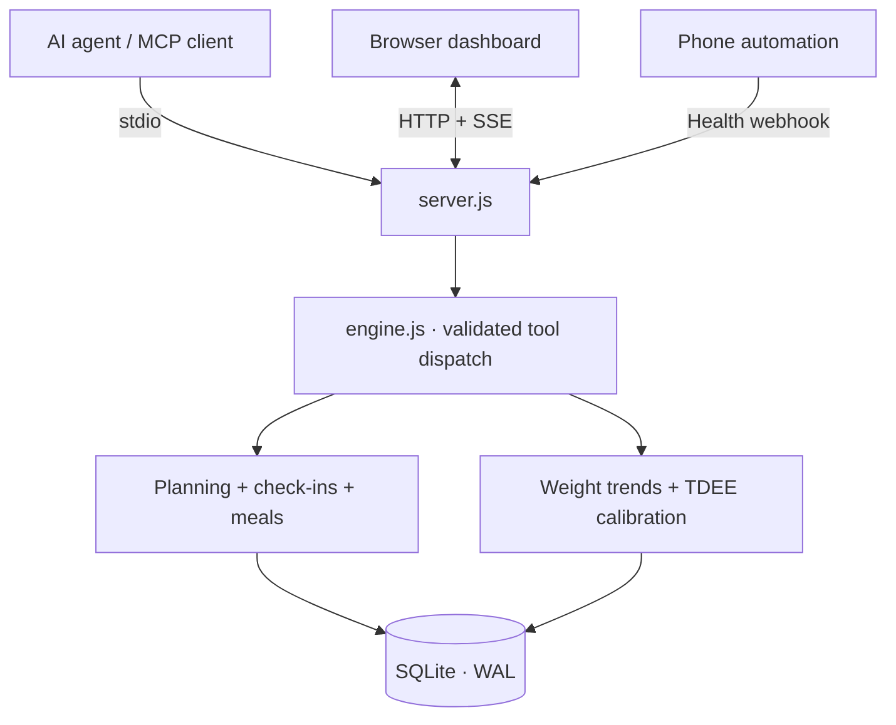

<div align="center">

# Nutrition Tracker MCP

**A local-first nutrition dashboard with an MCP interface and a feedback-driven calorie model.**

[](https://nodejs.org/) [](https://modelcontextprotocol.io/)  

**[Preview](#interface-preview) · [Quick start](#quick-start) · [Architecture](#architecture) · [MCP tools](#mcp-integration) · [Design decisions](#engineering-notes)**

</div>

---

This is a **personal engineering portfolio project**, not a hosted service. It explores how an AI assistant can interact with a deterministic, persistent nutrition engine without outsourcing numerical calculations or state management to the language model.

The application brings together daily food logging, weekly carb cycling, optional recovery signals, a weight-trend model, and conservative TDEE recalibration. An MCP client, browser dashboard, and phone webhook all read and write through **the same SQLite-backed engine**.

## Interface preview


*Actual dashboard UI with sample data (`npm run demo`); Simplified Chinese interface. The preview is an illustrative demo state, not personal health data.*

The visual direction is an **editorial training journal**: warm paper, ink-like typography, restrained vermilion, clear numerical hierarchy, and dense but legible data. The frontend is a single HTML/CSS/JavaScript file—no build pipeline required. See [`DESIGN.md`](DESIGN.md) for the original visual specification.

## Highlights

| | Capability | Implementation |
| --- | --- | --- |
| **01** | Weekly carb cycling | High / medium / low days; weekly-average P/C/F targets are normalized rather than independently improvised |
| **02** | Diet and supplement ledger | Meal portions, food library, daily totals, supplement check-ins, local persistence |
| **03** | Recovery inputs | Optional HRV, resting heart rate, sleep, activity, and weight check-ins |
| **04** | Adaptive TDEE | Weight-trend comparison, bounded corrections, calibration diagnostics |
| **05** | MCP-native controls | 10 tools and one read-only snapshot resource for an AI agent |
| **06** | Live observability | HTTP dashboard, SSE updates, SQLite WAL and cross-process change detection |

## Quick start

**Requirements:** Node.js **22.13+**, npm. The project uses the built-in `node:sqlite` module. No API keys, cloud service, database server, or frontend build are required.

```bash
git clone https://github.com/Jasonatafricanow/Nutrition-Tracker-MCP.git
cd Nutrition-Tracker-MCP
npm ci
npm run demo
```

Open **http://127.0.0.1:3456** for the populated demo dashboard.

For a separate persistent ledger (instead of the seeded demo database), stop the demo and run:

```bash
npm start
```

```bash
TZ=Asia/Shanghai npm test   # 10 Node test cases; see time-zone limitation below
```

The demo uses `macro_demo.db`; regular mode uses `macro_engine.db`. Database files and `node_modules` are ignored by Git.

## Architecture



**Boundary:** `server.js` owns transport, request routing and live updates. `engine.js` owns the model calculations, validation, storage and state transitions. The MCP interface **exposes** deterministic operations; it does **not** run its own LLM or independently generate training advice.

### Project layout

```text
Nutrition-Tracker-MCP/
├── engine.js                   # Nutrition model, tools, SQLite ledger
├── server.js                   # stdio MCP + HTTP API + SSE
├── viewport.html               # Standalone responsive dashboard
├── test/engine.test.js         # Node built-in test runner
├── assets/dashboard-preview.jpg
├── DESIGN.md                   # Interface design specification
├── package.json
├── package-lock.json
└── .github/workflows/ci.yml    # Reproducible test workflow
```

## MCP integration

Use this server as a local **stdio MCP** process. The path must point to your own checkout:

```json
{
  "mcpServers": {
    "nutrition-tracker-mcp": {
      "command": "node",
      "args": ["/absolute/path/to/Nutrition-Tracker-MCP/server.js"]
    }
  }
}
```

For Windows, use a path such as `C:/projects/Nutrition-Tracker-MCP/server.js`. Exact configuration locations vary by MCP host. Running in a terminal normally starts HTTP only; a client that connects over piped stdin activates the MCP transport as well.

| Tool | Purpose |
| --- | --- |
| `get_snapshot` | Read the current dashboard state, targets, history and diagnostics |
| `set_profile` | Update body parameters, activity factor, target and macro ratios |
| `log_morning_checkin` | Record weight, HRV, RHR, sleep and optional activity metrics |
| `calibrate_metabolic_tdee` | Apply a bounded TDEE adjustment from logged history |
| `set_day_context` | Override today's carb level and training context |
| `update_weekly_schedule` | Modify individual days or the weekly template |
| `log_meal_items` | Log portions from the food library or explicit macros |
| `delete_meal_item` | Remove a logged meal item |
| `add_food_to_library` | Extend the editable food library |
| `update_supplement_stack` | Mark today's supplement entry and dose text |

Read-only MCP resource: **`telemetry://snapshot`** (`application/json`).

## HTTP endpoints

| Method | Route | Use |
| --- | --- | --- |
| GET | `/` | Dashboard |
| GET | `/api/snapshot` | Complete JSON snapshot |
| GET | `/api/stream` | Server-Sent Events updates |
| POST | `/api/mcp-dispatch` | Invoke a validated engine tool |
| POST | `/api/health-webhook` | Import optional morning measurements |

Example health automation payload:

```bash
curl -X POST http://127.0.0.1:3456/api/health-webhook \
  -H 'Content-Type: application/json' \
  -d '{"weightKg":75.2,"hrvMs":62,"rhrBpm":56,"sleepHours":7.4,"source":"phone-automation"}'
```

The webhook accepts `weightKg` / `scaleWeightKg`, `hrvMs`, `rhrBpm`, `sleepHours`, `deepSleepPct`, `steps`, `activeKcal`, and `source`. It **does not** automatically connect to Apple Health or Google Health Connect; an external automation has to send the data.

| Environment variable | Default | Purpose |
| --- | --- | --- |
| `HOST` | `127.0.0.1` | HTTP bind address |
| `PORT` | `3456` | HTTP port |
| `DB_PATH` | project-local SQLite file | Override database path |

## Engineering notes

**Why a deterministic engine?** An assistant is good at interpreting a request, but calculations, mutation rules and persisted logs should produce repeatable results. Tool schemas validate inputs and the backend retains authority over state.

**Weekly budgeting, not seven unrelated targets.** Daily carb and fat multipliers are normalized against the actual weekly schedule, while protein stays constant. This keeps the week's intended energy/macronutrient budget approximately intact after rounding.

**Visible correction instead of hidden adaptation.** The calibration logic exposes inputs, intermediate estimates and limited TDEE steps (damping `0.35`, max correction `±120 kcal` per calibration, with an overall bounded range). Its glycogen/water adjustment, EWMA trend and seven-day projection are **heuristic assumptions**, not clinically validated estimators.

**Why SQLite and SSE?** One local ledger is shared across the MCP and web surfaces. SQLite WAL supports access from multiple processes; `PRAGMA data_version` polling lets an existing dashboard notice changes made by another instance. SSE keeps the browser dependency-free.

## Known limitations and security

- **Prototype / single-user** design. There is no account system, authentication, authorization or access isolation.
- **Keep the HTTP server on loopback.** The API currently uses permissive CORS, and reachable callers can read or mutate the ledger. Do **not** expose it directly to the public internet or a shared/untrusted network. Binding `HOST=0.0.0.0` is not an adequate security solution.
- **Interface language:** the dashboard, seeded food labels and many tool descriptions are in Simplified Chinese. English UI localization has not been implemented.
- **Dates/time zones:** current date calculation and two date-sensitive tests assume a specific process time zone. The CI workflow pins `Asia/Shanghai` to make the existing suite reproducible; multi-time-zone behavior is not verified.
- **Model assumptions:** readiness scoring, glycogen-associated water, calorie/weight projections and TDEE feedback are simplified heuristics. They are not diagnostic, medical or individualized nutrition recommendations.
- **No independent agent:** an external MCP client supplies the AI interface; the project does not bundle a language model or perform autonomous coaching.

### Project status

This repository is maintained as a **portfolio case study and experimental prototype**. It demonstrates end-to-end integration and design choices, not production hardening. The bundled test suite covers ten engine-level cases; it is not a substitute for broader validation, security review or clinical evidence.

The source is publicly visible. **No open-source license has been selected yet**; visibility alone does not grant reuse rights.
