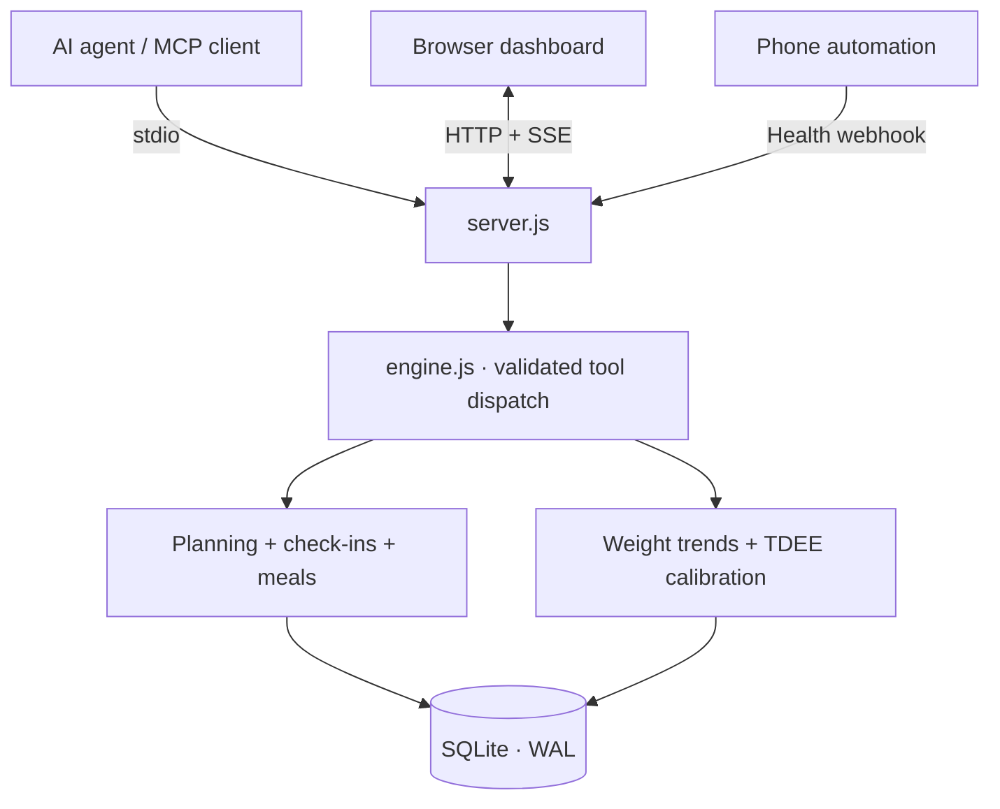

<div align="center">

# Nutrition Tracker MCP

**An agent-first nutrition MCP server with persistent food logging, reusable meals, and an optional monitoring dashboard.**

[](https://nodejs.org/) [](https://modelcontextprotocol.io/)  

**[Preview](#interface-preview) · [Quick start](#quick-start) · [Architecture](#architecture) · [MCP tools](#mcp-integration) · [Design decisions](#engineering-notes)**

</div>

---

This is a **personal engineering portfolio project built primarily as an MCP module for AI agents**, not a hosted service. Users communicate with an Agent; the Agent resolves intent, asks for missing portions or food preparation details, and calls deterministic, validated tools. The dashboard is **secondary**: it monitors and reviews persisted state rather than replacing the Agent workflow.

The application brings together daily food logging, weekly carb cycling, optional recovery signals, a weight-trend model, and conservative TDEE recalibration. An MCP client, browser dashboard, and phone webhook all read and write through **the same SQLite-backed engine**.

## v5.2 experimental: Agent-first quick logging

**Experimental branch:** `experiment/agent-first-quick-log` (not merged into main). Agent/MCP is the primary interaction surface; the Dashboard remains optional.

| New/extended MCP tool | Use |
| --- | --- |
| `get_agent_context` | Compact daily targets, intake, remaining macro budget, recent meals, and template names |
| `search_foods` | Keyword search by food name and nutrient values per 100g; no full snapshot required |
| `get_meal_history` | Read previous meals on a specific calendar date |
| `log_meal_items` (extended) | Log a confirmed meal for today or a past date; optional `requestId` prevents duplicate writes during Agent retries |
| `save_meal_template` | Snapshot a meal from a real logged date and meal slot |
| `list_meal_templates` | Find reusable meal templates with recorded portions and macros |
| `log_meal_template` | Reuse a saved meal with an optional portion multiplier and idempotency key |
| `export_nutrition_data` | Export at most 90 calendar days of ledger and meal history as JSON |

**Example Agent interaction:** “I ate 200g chicken breast and 150g cooked rice for lunch. Save that as my usual office lunch.” The Agent should search ingredients, **confirm raw/cooked status and actual measured quantities**, then invoke `log_meal_items` followed by `save_meal_template`. Future repeats use `list_meal_templates` and `log_meal_template`.

```json
{"tool":"log_meal_items","args":{"mealSlot":"午餐","items":[{"foodId":"f1","weightGrams":200},{"foodId":"f7","weightGrams":150}],"requestId":"single-confirmed-action-123"}}
```

**Boundaries:** no embedded LLM, no autonomous food guessing, no photo recognition, no external food search, no automatic intake completion. Editing historical meals invalidates their daily completion flag. `requestId` must be unique per confirmed write and **stable across its retries**. Templates freeze previously recorded macros and never silently change when food-library values change. The v5.1 TDEE confirmation requirement remains.

See [Agent workflow reference](docs/AGENT_WORKFLOWS.md).

## Interface preview


*Actual dashboard UI with sample data (`npm run demo`); Simplified Chinese interface. The preview is an illustrative demo state, not personal health data.*

The visual direction is an **editorial training journal**: warm paper, ink-like typography, restrained vermilion, clear numerical hierarchy, and dense but legible data. The frontend is a single HTML/CSS/JavaScript file—no build pipeline required. See [`DESIGN.md`](DESIGN.md) for the original visual specification.

## Highlights

| | Capability | Implementation |
| --- | --- | --- |
| **01** | Weekly carb cycling | High / medium / low days; weekly-average P/C/F targets are normalized rather than independently improvised |
| **02** | Diet and supplement ledger | Meal portions, food library, daily totals, supplement check-ins, local persistence |
| **03** | Recovery inputs | Optional HRV, resting heart rate, sleep, activity, and weight check-ins |
| **04** | Adaptive TDEE | Weight-trend comparison, bounded corrections, calibration diagnostics |
| **05** | MCP-native controls | 18 tools and one read-only snapshot resource for an AI agent |
| **06** | Live observability | HTTP dashboard, SSE updates, SQLite WAL and cross-process change detection |

## v5.1 correctness and safety changes

This release separates **observations** from **assumptions** and makes TDEE adjustments **opt-in**. It is an engineering prototype, not a validated clinical prediction model.

- TDEE calibration now uses the actual calendar span and only days whose intake has explicitly been marked complete. Missing records are never interpreted as zero calories.
- Calibration requests produce a **read-only preview by default**; `apply: true` is required to write. The same evidence cannot repeatedly move TDEE even with `force: true`.
- EWMA uses **measured scale weight**, not carbohydrate-preset glycogen-water subtraction. Glycogen and forecast outputs remain unvalidated illustrative scenarios.
- Recovery scores are heuristic indicators only; they **never automatically switch a training day to a low-carb day**, prescribe supplements, or assert CNS fatigue.
- Health data accepts an optional `measuredAt` with a time-zone offset and `sourceEventId` for deduplication; HRV inputs must specify `RMSSD` or `SDNN` (SDNN is not compared to the default RMSSD baseline).
- Browser writes use a same-origin session CSRF token, programmatic writes require `NUTRITION_API_TOKEN`, and health webhooks are disabled unless `HEALTH_WEBHOOK_TOKEN` is configured. Do not publicly expose the server without additional authentication and transport security.

**New workflow:** after finishing each day's intake, use the dashboard's **今日饮食已记录完整** button or the `mark_intake_complete` MCP tool. Updating logged meals resets the completion flag. For TDEE use `calibrate_metabolic_tdee({windowDays: 14})` to preview, then only after review `calibrate_metabolic_tdee({windowDays: 14, apply: true})`.

**Time-zone configuration:** set `NUTRITION_TIME_ZONE` to your IANA time zone (e.g. `Africa/Maputo`, `Asia/Shanghai`, `Europe/London`). Existing data is **not automatically migrated between time zones**; set the correct zone before collecting data.

**Authenticated HTTP examples:**

```bash
NUTRITION_TIME_ZONE=Africa/Maputo HEALTH_WEBHOOK_TOKEN=change-me npm start
curl -X POST http://127.0.0.1:3456/api/health-webhook \
  -H 'Authorization: Bearer change-me' -H 'Content-Type: application/json' \
  -d '{"source":"phone","sourceEventId":"measurement-123","measuredAt":"2026-10-17T07:00:00+02:00","scaleWeightKg":75.0}'
```

Tokens must be kept private; do not commit them to Git. The local browser dashboard obtains its own ephemeral write token via `/api/session` and does not need an environment variable. Programmatic HTTP tools can use `NUTRITION_API_TOKEN` as a Bearer token; stdio MCP remains separate.

**Migration notes:** older databases are migrated in-place by adding columns. Previous weight EWMA values and historical intake records are **not certified as complete**. Reconfirm logs before calibration; retain a backup of your SQLite file. The deprecated `dewatered_weight_kg` column now mirrors scale weight for newly processed readings. Earlier historical values are not bulk overwritten unless weight trends are recomputed.

## Quick start

**Requirements:** Node.js **22.13+**, npm. The project uses the built-in `node:sqlite` module. No API keys, cloud service, database server, or frontend build are required.

```bash
git clone https://github.com/Jasonatafricanow/Nutrition-Tracker-MCP.git
cd Nutrition-Tracker-MCP
npm ci
npm run demo
```

Open **http://127.0.0.1:3456** for the populated demo dashboard.

For a separate persistent ledger (instead of the seeded demo database), stop the demo and run:

```bash
npm start
```

```bash
npm test                # original regressions + new adversarial tests
```

The demo uses `macro_demo.db`; regular mode uses `macro_engine.db`. Database files and `node_modules` are ignored by Git.

## Architecture



**Boundary:** `server.js` owns transport, request routing and live updates. `engine.js` owns the model calculations, validation, storage and state transitions. The MCP interface **exposes** deterministic operations; it does **not** run its own LLM or independently generate training advice.

### Project layout

```text
Nutrition-Tracker-MCP/
├── engine.js                   # Nutrition model, tools, SQLite ledger
├── server.js                   # stdio MCP + HTTP API + SSE
├── viewport.html               # Standalone responsive dashboard
├── test/engine.test.js         # Node built-in test runner
├── assets/dashboard-preview.jpg
├── DESIGN.md                   # Interface design specification
├── package.json
├── package-lock.json
└── .github/workflows/ci.yml    # Reproducible test workflow
```

## MCP integration

**Primary interface:** connect the local stdio MCP server to your AI Agent. No dashboard interaction is required for logging, templates, history or export.

Use this server as a local **stdio MCP** process. The path must point to your own checkout:

```json
{
  "mcpServers": {
    "nutrition-tracker-mcp": {
      "command": "node",
      "args": ["/absolute/path/to/Nutrition-Tracker-MCP/server.js"]
    }
  }
}
```

For Windows, use a path such as `C:/projects/Nutrition-Tracker-MCP/server.js`. Exact configuration locations vary by MCP host. Running in a terminal normally starts HTTP only; a client that connects over piped stdin activates the MCP transport as well.

| Tool | Purpose |
| --- | --- |
| `get_agent_context` | Compact Agent-oriented daily state, without the large snapshot |
| `get_snapshot` | Read the full state, targets, history and diagnostics |
| `set_profile` | Update body parameters, activity factor, target and macro ratios |
| `log_morning_checkin` | Record weight, HRV, RHR, sleep and optional activity metrics |
| `calibrate_metabolic_tdee` | Preview the TDEE estimate; optionally apply with explicit approval |
| `mark_intake_complete` | Confirm or reopen a specific day’s intake log |
| `set_day_context` | Override today's carb level and training context |
| `update_weekly_schedule` | Modify individual days or the weekly template |
| `log_meal_items` | Log meals today or historically; optional retry-safe requestId |
| `search_foods` | Discover foods by name and per-100g macros |
| `get_meal_history` | Inspect meals for one selected day |
| `save_meal_template` | Save a logged meal as a nutritional snapshot |
| `list_meal_templates` | Find existing meal templates |
| `log_meal_template` | Record a scaled meal template into the ledger |
| `export_nutrition_data` | Export up to 90 days of ledger and meals as JSON |
| `delete_meal_item` | Remove a logged meal item |
| `add_food_to_library` | Extend the editable food library |
| `update_supplement_stack` | Mark today's supplement entry and dose text |

Read-only MCP resource: **`telemetry://snapshot`** (`application/json`).

## HTTP endpoints

| Method | Route | Use |
| --- | --- | --- |
| GET | `/` | Dashboard |
| GET | `/api/snapshot` | Complete JSON snapshot |
| GET | `/api/session` | Same-origin dashboard write token |
| GET | `/api/stream` | Server-Sent Events updates |
| POST | `/api/mcp-dispatch` | Invoke a validated engine tool |
| POST | `/api/health-webhook` | Import optional morning measurements |

The optional webhook accepts `weightKg` / `scaleWeightKg`, `hrvMs`, `hrvMetric`, `rhrBpm`, `sleepHours`, `deepSleepPct`, `steps`, `activeKcal`, `measuredAt`, `sourceEventId`, and `source`. It requires `Authorization: Bearer $HEALTH_WEBHOOK_TOKEN` and is disabled until that environment variable is configured. It does **not** connect directly to Apple Health or Health Connect.

| Environment variable | Default | Purpose |
| --- | --- | --- |
| `HOST` | `127.0.0.1` | HTTP bind address; do not expose publicly |
| `PORT` | `3456` | HTTP port |
| `DB_PATH` | project-local SQLite file | Override database path |
| `NUTRITION_TIME_ZONE` | host IANA time zone | Personal ledger date/time-zone attribution |
| `NUTRITION_API_TOKEN` | unset | Optional Bearer token for trusted programmatic HTTP writes |
| `HEALTH_WEBHOOK_TOKEN` | unset (disabled) | Required Bearer token for incoming health webhooks |

## Engineering notes

**Why a deterministic engine?** An assistant is good at interpreting a request, but calculations, mutation rules and persisted logs should produce repeatable results. Tool schemas validate inputs and the backend retains authority over state.

**Weekly budgeting, not seven unrelated targets.** Daily carb and fat multipliers are normalized against the actual weekly schedule, while protein stays constant. This keeps the week's intended energy/macronutrient budget approximately intact after rounding.

**Visible correction instead of hidden adaptation.** The calibration logic exposes inputs, intermediate estimates and limited TDEE steps (damping `0.35`, max correction `±120 kcal` per calibration, with an overall bounded range). Its carb-day glycogen/water scenarios and seven-day projections are **heuristic assumptions**, not clinically validated estimators. Calibration uses an ordinary least-squares trend over raw scale-weight observations and checks whether the disagreement exceeds an estimated measurement-noise threshold. This does **not** account for dietary underreporting or establish metabolic adaptation.

**Why SQLite and SSE?** One local ledger is shared across the MCP and web surfaces. SQLite WAL supports access from multiple processes; `PRAGMA data_version` polling lets an existing dashboard notice changes made by another instance. SSE keeps the browser dependency-free.

## Known limitations and security

- **Prototype / single-user** design. Browser write protection is based on same-origin CSRF tokens; programmatic HTTP writes use a manually configured bearer token. It is not a multi-user auth system. Local processes can reach the loopback interface. Keep the HTTP server on `127.0.0.1` and do not expose it on an untrusted network.
- **Interface language:** the dashboard, labels and many tool descriptions are in Simplified Chinese; English UI localization is not implemented.
- **Time zones:** set `NUTRITION_TIME_ZONE` to an explicit IANA zone before collecting data. The automated test suite runs under Asia/Shanghai, UTC and Europe/London environments.
- **Scientific assumptions:** recovery indicators, calorie-to-weight conversion, carbohydrate-day glycogen scenarios, calorie-burn day factors and seven-day forecasts are simplified assumptions, not diagnostic or clinically validated predictions.
- **Data completeness:** old food logs have no reliable completion flag and are intentionally excluded from calibration until confirmed. Even completed food logs can be inaccurate; a complete flag is not proof of a correct record.
- **No independent agent:** the MCP interface exposes deterministic tools to external LLM clients; there is no embedded language model or autonomous coaching.
- **Feedback estimation:** the noise-aware regression is an engineering guardrail checked against synthetic data, not a validated uncertainty interval for real-world metabolism. Calibration never applies automatically.

### Project status

This repository is maintained as a **portfolio case study and experimental prototype**. It demonstrates end-to-end integration and design choices, not production hardening. The suite includes engine, agent-first and HTTP regression tests plus a synthetic-noise comparison (`node audit/compare-montecarlo.mjs`, requires the v5.0 historical commit in a full Git clone). These are not a substitute for longitudinal human validation, professional security review or clinical evidence.

The source is publicly visible. **No open-source license has been selected yet**; visibility alone does not grant reuse rights.
