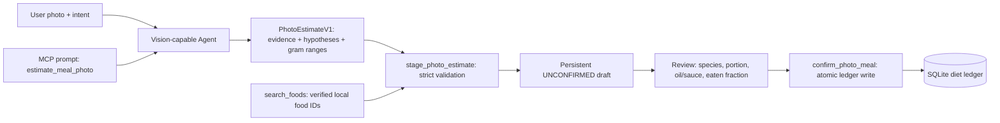

# Meal photograph → compiled nutrition estimate (v1)

**Purpose:** provide a schema-constrained, evidence-carrying intermediate representation (IR) from an external multimodal Agent to a deterministic MCP nutrition ledger. **MCP does not analyze images.** The user shares the photograph with the Agent host, which invokes `estimate_meal_photo` (MCP prompt) or obtains the identical instructions from `get_photo_estimation_protocol` (MCP tool). The Agent runs visual inference and sends the result to `stage_photo_estimate`.

`photo-estimation.js` is the single source of truth for the prompt, output schema and example. This page explains the contract; it is not a competing prompt.

## Pipeline



**Trust boundaries:** visual evidence is an *observation*; type and mass are *model estimates*; ingredient IDs are *verified lookup results*; a user's confirmed or measured mass is a separate provenance type. No photograph, raw image bytes, model-made nutrient macros or inferred known-size plate diameter are stored in the diet ledger.

## Required compilation fields

- `schemaVersion`: fixed `nutrition.photo_estimate.v1`; reject unmatched versions.
- `imageAssessment`: camera angle, independently known scale (`known_size`, `unverified_plate`, `none`), image limitations.
- `items[]`: stable item index, predicted name, raw/cooked/mixed state, **visible evidence**, possible alternative identities, identification confidence, occlusion, edible gram estimate plus lower/upper bounds and method.
- `hiddenOrUnquantified[]`: oil, dressing, invisible fillings, drinks, shared food and other relevant unobserved intake; **do not assign artificial grams**.
- `questions[]`: only high-information follow-ups that meaningfully change food identity or estimated quantity.
- `coverage`: whether visible food appears complete or partly hidden/out of frame. This is **not** a claim that all food consumed was photographed.

The producer must emit **JSON only**, not a conversational caption. The downstream schema deliberately has no calories, protein, carbohydrate, fat, `foodId`, or claim that grams are measured. Those are resolved independently.

## Gram-estimation guidance

1. Segment rice, meat, vegetables, sauce and side dishes rather than calling the whole plate “one meal.”
2. Classify preparation state; 150 g raw rice and 150 g cooked rice are very different nutritional references.
3. Use counts, geometry and *independently calibrated size references* when they exist. With known dimensions, approximate edible volume and suitable food-density, reporting broad uncertainty; without a scale reference, offer a wide range or `not_estimable`.
4. Distinguish food identification confidence from quantity certainty. An obvious fried egg can have a clearly visible identity yet unclear grams if obscured.
5. Do not silently account for unknown oils, dressings, bones, plate leftovers or how much a user actually ate. Ask only for the missing detail that matters.

This method **does not guarantee accurate weight or energy estimates**. Most ordinary photos lack enough geometric information for measured grams. Reliable calibration requires user-provided quantities, size references or an external labeled-photo benchmark; the included tests only assess schema and flow correctness.

## Example tool sequence

1. Agent receives user's attached meal photo and request to record it.
2. `prompts/get: estimate_meal_photo` (or `get_photo_estimation_protocol` for clients without MCP Prompt UI).
3. Agent produces a structured estimate; for an example, see `PHOTO_ESTIMATE_EXAMPLE` in `photo-estimation.js`.
4. Agent calls `search_foods({"query":"熟白米饭"})`, **checks** that the result refers to cooked rice, then binds a returned food ID to an item.
5. Agent calls `stage_photo_estimate` with the IR and resolved matches:

```json
{
  "mealSlot": "午餐",
  "estimate": { "schemaVersion": "nutrition.photo_estimate.v1", "imageAssessment": { "view": "oblique", "scaleReference": "none", "limitations": ["No known-size reference"] }, "items": [{ "id": "item-1", "predictedName": "熟米饭", "foodState": "cooked", "identificationConfidence": "high", "visibleEvidence": ["Individual rice grains visible"], "alternativeNames": [], "ediblePortion": { "grams": 180, "minGrams": 110, "maxGrams": 260, "method": "visual_only", "evidence": "Uncalibrated mound occupying part of plate; wide plausible range" }, "obscured": false }], "hiddenOrUnquantified": ["Oil and side dishes outside photograph unknown"], "questions": ["这盘你全部吃了吗？", "米饭大概是一小碗还是两碗？"], "coverage": "partial_or_obscured" },
  "matches": [{ "itemId": "item-1", "foodId": "f7" }]
}
```

6. Tool returns an **unconfirmed persistent draft**, computed nutrition preview for matched foods, unresolved questions and missing ingredient matches. It never changes daily intake.
7. User reviews food type, estimate/portion and hidden ingredients. Agent calls `confirm_photo_meal({"draftId":"...","confirmed":true,"requestId":"unique-per-confirmed-meal","decisions":[{"index":0,"include":true,"weightGrams":180,"portionSource":"visual_estimate"}]})`. If unknown items remain, exclude them explicitly and show `partial:true`. `requestId` must be stable across retries but new for another meal.
8. Agent summarizes the **estimated** result and outstanding uncertainty. Do not mark the full day complete merely because a photo meal was logged.

The Agent may use user answers to refine the proposed item name/grams in step 7; it must not change the archived original vision IR silently. For corrections after commit, use existing history/delete/record tools with explicit user intent.

## What is actually tested

- Schema rejects free-form captions, invented exact visual weights, impossible bounds and unknown keys.
- `stage_photo_estimate` rejects unmapped/invalid food IDs, stores provenance and leaves the food ledger unchanged.
- Persistent draft can be recovered and explicitly confirmed; multi-item decisions and retry behavior are checked.
- MCP Prompt discovery and tool invocation run through a real stdio client.

**Not tested:** real model image-recognition accuracy, grams MAE on actual weighed meals, oil detection performance, generalization to unfamiliar cuisines, or automatic classification of inedible portions. Those require an annotated image set.
